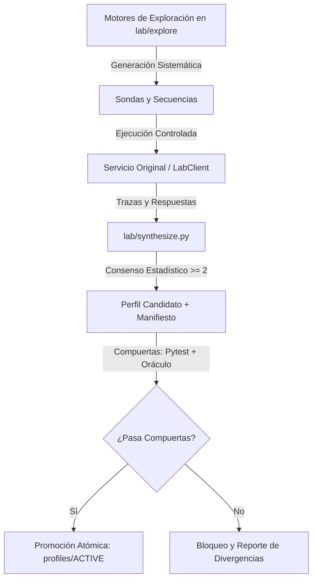

# BlackBox — Reverse Engineering, Autonomous Learning & Service Replacement

Proyecto para resolver el **Reto 2: La caja negra**. Consiste en entender el comportamiento de un servicio HTTP bancario heredado sin documentación mediante experimentación controlada, y construir una réplica compatible de alta fidelidad que se adapta de manera 100% autónoma a cambios de versión del proveedor.

---

## Entregables Principales

1. **Reemplazo desplegado**: Servicio ASGI accesible públicamente con contrato de entrypoint (`GET /health`, `POST /__reset`, `POST /msg`, `/*`).
2. **Especificación formal** ([`especificacion.md`](especificacion.md)): Taxonomía estructurada de comportamientos (`confirmado`, `probable`, `supuesto`), tablas exhaustivas y trazabilidad al log de experimentos.
3. **Log de experimentos** ([`experimentos.jsonl`](experimentos.jsonl)): Registro auditable de cada interacción con el servicio original, registrando hipótesis, payloads y respuestas exactas.
4. **Debrief de incidente** ([`debrief.md`](debrief.md)): Análisis técnico formal del incidente #FR-0153 (despliegue de la versión 2 del proveedor).

---

## Estructura del Repositorio

```text
.
├── Dockerfile                  # Empaquetado de producción (un solo worker ASGI)
├── README.md                   # Documentación general, guía operativa y de benchmark
├── debrief.md                  # Debrief técnico del incidente #FR-0153 (versión 2)
├── especificacion.md           # Especificación formal del protocolo
├── experimentos.jsonl          # Log de experimentos auditables
├── audit.jsonl                 # Registro de auditoría técnica (latencias, timestamps, infra)
├── profiles/                   # Perfiles declarativos versionados de protocolo
│   ├── ACTIVE                  # Puntero atómico a la versión activa (ej. 20261010T220931Z)
│   └── <timestamp>/            # Versión inmutable (profile.json, manifest.json, diff.md)
├── src/                        # Código del reemplazo evaluado
│   ├── main.py                 # Entrypoint ASGI, enrutador, validación de cuerpo y auth
│   ├── config.py               # Configuración y variables de entorno
│   ├── protocol.py             # Parser de mensajes, checksum ISO 7064 y validaciones
│   ├── state.py                # Ledger transaccional en memoria y EFSM concurrente
│   └── profile.py              # Carga, validación y resolución atómica de perfiles
├── lab/                        # Laboratorio de ingeniería inversa autónoma
│   ├── benchmark.py            # Fast testing y benchmark diferencial contra URL original y réplica
│   ├── learn.py                # Orquestador del pipeline de aprendizaje y promoción autónoma
│   ├── synthesize.py           # Síntesis estadística con regla de consenso (>= 2 observaciones)
│   ├── versioning.py           # Gestión y publicación de perfiles versionados
│   ├── client.py               # Cliente HTTP seguro con rate-limiting y lockfile
│   └── explore/                # Motores de exploración genérica (CERO payloads manuales)
│       ├── boundaries.py       # Búsqueda binaria de límites numéricos (transfer_limit, max_body_bytes)
│       ├── precedence.py       # Inferencia de orden de evaluación de errores
│       ├── shapes.py           # Inferencia de tipos y formatos de respuesta (saldo decimal vs entero)
│       ├── inputs.py           # Mutaciones gramaticales de métodos, rutas, auth y mensajes
│       ├── stateful.py         # Generador de cadenas financieras complejas (6-12 pasos)
│       ├── replay.py           # Replay histórico y clustering de divergencias entre versiones
│       └── targets.py          # Adaptadores para Original (Live), Réplica (In-Process) y URL Remota
└── tests/                      # Banco de 114 pruebas herméticas automatizadas (<2s)
```

---

## Arquitectura Autónoma (Sin Payloads Manuales ni Intervención Asistida)

Este sistema **no utiliza tablas estáticas, payloads inventados a mano ni hipótesis redactadas por un LLM**. Todo el descubrimiento, caracterización y validación del contrato se realiza mediante **código y motores de exploración deterministas**:



### Motores de Exploración (`lab/explore/`):
1. **`boundaries.py`**: Búsqueda binaria automatizada sobre parámetros numéricos. Determinó que el límite de transferencias en v2 se redujo exactamente a `50.000` y descubrió el límite de payload HTTP en `8.192` bytes (`413 E101`).
2. **`precedence.py`**: Construye entradas que violan pares de restricciones concurrentemente (ej. monto > límite y saldo insuficiente simultáneamente). Determinó que en v2 `max_amount` (E506) se evalúa antes que `sufficient_balance` (E507).
3. **`shapes.py`**: Infiere el tipo de dato y formato de respuesta a partir de las trazas observadas. Detectó que `CONSULTA` cambió de enteros a strings decimales (`"0.00"`).
4. **`inputs.py`**: Generador gramatical sistemático sobre 4 familias (HTTP, autenticación, cuerpo JSON y delimitadores/aridad). Mapeó el 100% de los códigos sintácticos y el soporte UTF-8 BOM.
5. **`stateful.py`**: Generador de cadenas complejas de 6 a 12 pasos (altas, depósitos, transferencias, dobles anulaciones) manteniendo un modelo de estado dinámico a partir de respuestas reales. Descubrió la regla ISO 7064 MOD 97-10 (resto 0 $\rightarrow$ control 98).
6. **`replay.py`**: Re-ejecuta segmentos limpios registrados en el log para agrupar divergencias entre versiones de manera no supervisada.

---

## Guía Operativa: Fast Testing y Verificación de Mejoras

Para iterar de forma rápida y contrastar la fidelidad del reemplazo contra el original, disponemos de tres herramientas automáticas:

### 1. Fast Parity Benchmark (`lab.benchmark`)

Ejecuta una batería de secuencias categorizadas (**Fáciles** de 1 paso, **Regulares** de 2-5 pasos y **Difíciles** de 6-12 pasos) contra ambos objetivos, mide la tasa de éxito y desglosa las divergencias:

#### A) Comparar Original en Vivo vs Réplica Local (In-Process):
```bash
uv run python -m lab.benchmark --live --budget 80
```

#### B) Comparar Original en Vivo vs URL Remota Desplegada:
```bash
uv run python -m lab.benchmark --live --replica-url https://blackbox.up.railway.app --budget 80
```

#### C) Fast Testing Local Hermético (Cero consumo de red, <1s):
```bash
uv run python -m lab.benchmark --budget 50
```

#### Ejemplo de Salida del Benchmark:
```text
=================================================================
           BENCHMARK DE CONFORMIDAD DIFERENCIAL (AUTÓNOMO)
=================================================================
ORIGINAL:  Live Original (https://caja-negra-production-c64f.up.railway.app)
RÉPLICA:   Local In-Process Replica (FastAPI TestClient)
REQUESTS:  73 requests ejecutados
-----------------------------------------------------------------
TESTS QUE PASAN:         19 / 19 (100.0%)
-----------------------------------------------------------------
FÁCILES (1 paso)         : 10 / 10 (100.0%)
REGULARES (2-5 pasos)    : 6 / 6 (100.0%)
DIFÍCILES (6-12 pasos)   : 3 / 3 (100.0%)
-----------------------------------------------------------------
POR QUÉ FALLAN:
  Status distinto:                0
  Cuerpo distinto:                0
  Caen en el primer request:      0
  Caen más adelante en secuencia: 0
-----------------------------------------------------------------
✅ 100% PARIDAD ABSOLUTA: Cero divergencias detectadas.
=================================================================
```

---

### 2. Pipeline de Aprendizaje Autónomo y Promoción (`lab.learn`)

Ejecuta el ciclo de exploración completa, genera el perfil candidato con trazabilidad por `id` de experimento en `manifest.json`, valida las compuertas y promueve el perfil activo:

```bash
# Ejecutar ciclo autónomo completo en vivo
uv run python -m lab.learn --autonomous --live --budget 600 --profiles-dir profiles

# Verificación de paridad canaria (sin mutar perfiles ni estado)
uv run python -m lab.learn --check
```

---

### 3. Batería de Pruebas Automatizadas (114 tests herméticos en <2s)

Ejecuta la totalidad de pruebas unitarias, de contrato bancario, precedencia de errores, oráculo de replay histórico y validación de motores de exploración:

```bash
uv run pytest
```

---

## Ejecución y Despliegue del Reemplazo

### Variables de entorno
```bash
cp .env.example .env
# Configura TEAM_TOKEN con el token asignado
```

### Ejecución local
```bash
uv run uvicorn src.main:app --host 0.0.0.0 --port 8000
```

### Despliegue con Docker
```bash
docker build -t blackbox .
docker run -p 8000:8000 -e TEAM_TOKEN="tu-token" blackbox
```
